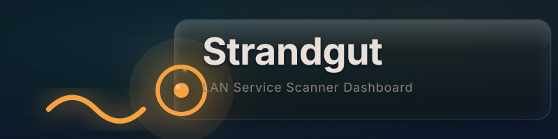

<p align="center">
  
</p>

<p align="center">
  <a href="https://github.com/RouHim/strandgut/actions/workflows/ci.yml"></a>
  <a href="https://github.com/RouHim/strandgut/pkgs/container/strandgut"></a>
  <a href="https://opensource.org/licenses/MIT"></a>
  <a href="https://github.com/RouHim/strandgut/releases/latest"></a>
  
</p>

## Features

- **Auto-discover services on your network** — scan any host and Strandgut identifies what's running. Recognizes Home Assistant, Proxmox, Pi-hole, Synology, Portainer, Jellyfin, Plex, and Nextcloud automatically.
- **Three scan depths** — Simple (common ports), Medium (extended range), or Deep (all 65,535 ports), with progress and results in the scan dialog.
- **See what is up** — every tile carries a reachability dot: the page checks each service when it loads (green = answering, red = not).
- **Rearrange your dashboard** — drag cards where you want them.
- **Dark theme** — one composed dark theme; no theme flash, no light-mode drift.
- **English and German** — picks up your browser language automatically.
- **Single file, no setup** — one binary with the entire UI embedded. No runtime dependencies, no install scripts.

## Quick start

```bash
git clone https://github.com/RouHim/strandgut.git
cd strandgut
cargo run
```

Open `http://localhost:13569` and click **Scan network**. The default scan (`simple`) checks 9 common ports, so it finishes in a couple of seconds.

### Docker

```bash
docker compose up -d
```

Also at `http://localhost:13569`.

Strandgut probes reachability with plain TCP connects, so the container needs no extra capabilities or sysctls.

The compose file mounts `./data` as a volume for persistent config. Write your own `data/config.toml` or use the dashboard UI to save one.

### Production container

The release container is built `FROM scratch` and contains only the statically linked musl binary. It's about 5 MB. Pull it from GHCR:

```bash
docker pull ghcr.io/RouHim/strandgut:latest
docker run -p 13569:13569 -v ./data:/data ghcr.io/RouHim/strandgut:latest
```
> **Note**: Host reachability during a scan is a TCP connect to the probed port. No raw sockets, no ICMP, no privileged mode.

### Standalone binary

Pre-built statically linked binaries are available for x86_64 and arm64 on every release:

```bash
# x86_64 / amd64
curl -L -o strandgut https://github.com/RouHim/strandgut/releases/latest/download/strandgut-x86_64-unknown-linux-musl
chmod +x strandgut
./strandgut

# arm64 / aarch64
curl -L -o strandgut https://github.com/RouHim/strandgut/releases/latest/download/strandgut-aarch64-unknown-linux-musl
chmod +x strandgut
./strandgut
```

No libc, no runtime, no system dependencies. Just download and run.

Set `STRANDGUT_CONFIG` if you need a config file somewhere else:

```bash
STRANDGUT_CONFIG=/etc/strandgut/config.toml ./strandgut
```

## Configuration

Strandgut looks for `config.toml` in the working directory. Set `STRANDGUT_CONFIG` to point it somewhere else. Logging is controlled with the `RUST_LOG` environment variable (via `env_logger`).

```toml
title = "Strandgut"
# language = "en"        # optional: "en" or "de"; omit to follow the browser
scan_defaults = "simple" # "simple", "medium", or "deep"
background_rotate = false # needs PEXELS_API_KEY, see below

[[services]]
name = "Home Assistant"
url = "http://192.168.1.100:8123"
icon = "homeassistant"
description = "Smart home control"
position = { row = 0, col = 0 }

[[services]]
name = "Pi-hole"
url = "http://192.168.1.1:80/admin"
icon = "pihole"
position = { row = 1, col = 0 }
```

Unknown top-level keys are rejected: the config file is parsed strictly, so a typo surfaces as an
error on the next read instead of being silently ignored. Service entries tolerate unknown keys so
older config files keep loading.

`icon` is a slug. A tile tries Dashboard Icons, then Simple Icons, then selfh.st; when none of them
has the slug, the card shows a neutral placeholder glyph. `description` is stored and editable but
not rendered on the card. `position` decides where the card sits in the grid.

Background rotation calls the [Pexels](https://www.pexels.com) API and needs an API key in the environment:

```bash
PEXELS_API_KEY=your-key ./strandgut
```

Without that variable the feature reports itself as unavailable and the toggle stays inert; the rest of the dashboard is unaffected.

## Development

```bash
git clone https://github.com/RouHim/strandgut.git
cd strandgut

# Run locally
cargo run

# Format
cargo fmt

# Lint (warnings are errors in CI)
cargo clippy -- -D warnings

# Run Rust unit tests
cargo test

# Run E2E tests (requires Node.js 26)
cargo build --release    # the webServer waits 60 s, cold release builds take longer
cd e2e
npm ci
npx playwright install --with-deps chromium
npm test
```

## Contributing

PRs welcome. See [CONTRIBUTING.md](CONTRIBUTING.md) for the development setup, code style, and pull request checklist.

## Security

See [SECURITY.md](SECURITY.md) for the security policy and how to report vulnerabilities.

## License

MIT — see [LICENSE](LICENSE).
